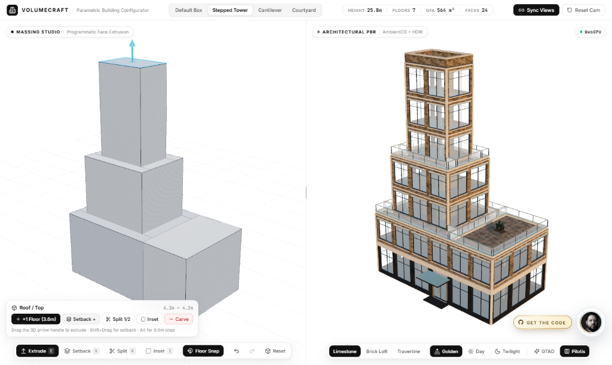
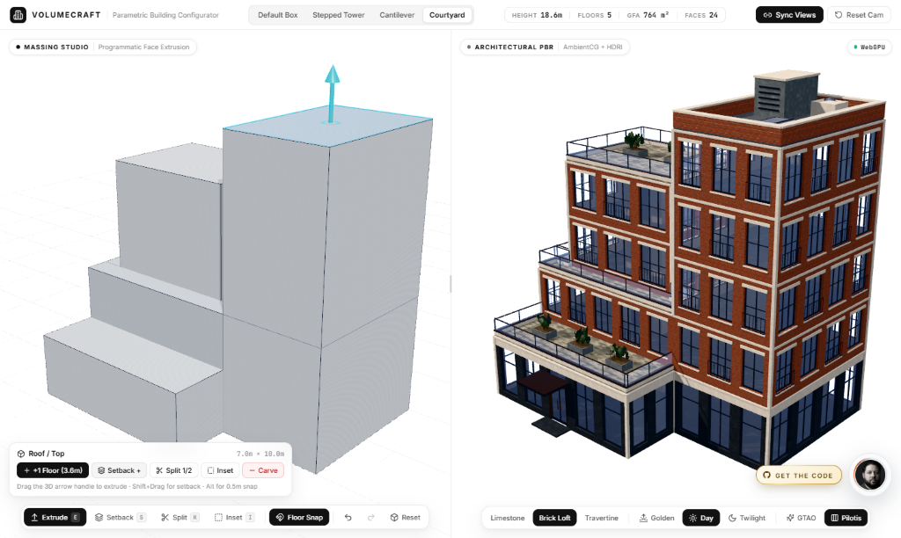
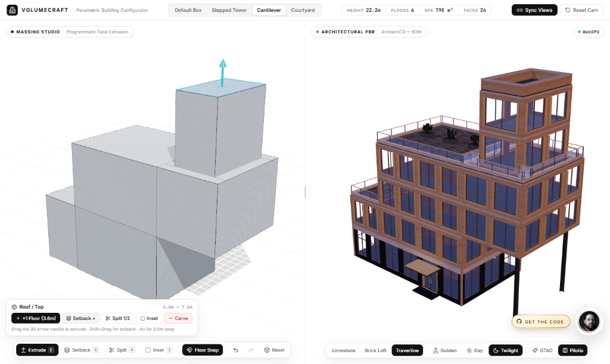
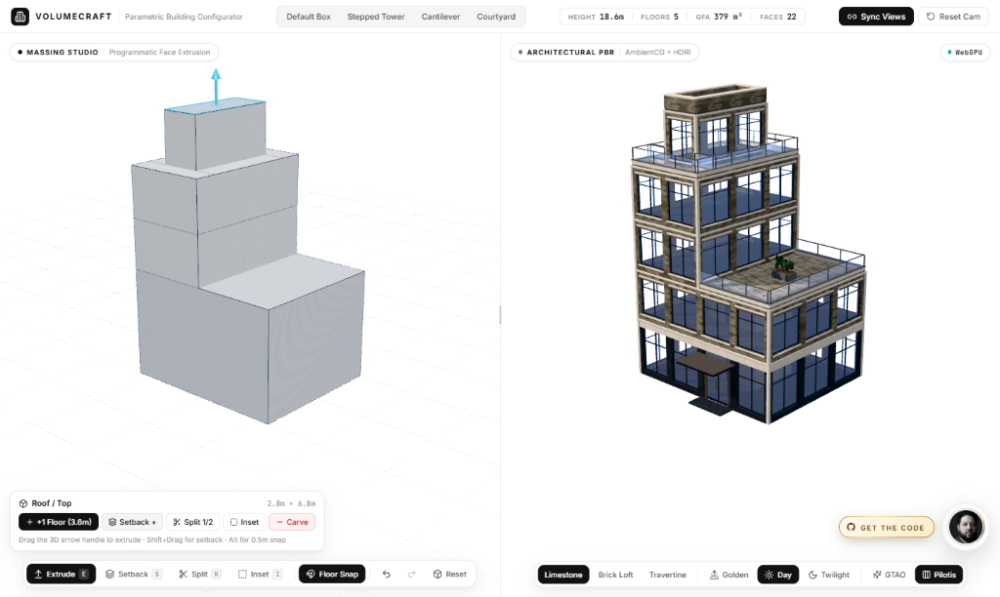

# VolumeCraft — Parametric Building Configurator

[](LICENSE)
[](https://threejs.org/)
[](https://www.typescriptlang.org/)
[](https://react.dev/)
[](https://vite.dev/)

A free, open-source (**MIT**) parametric building configurator built with **Three.js (WebGPU + TSL)**, **React**, and **TypeScript**. Sculpt architectural massing interactively on the left **Massing Studio** CAD viewport—extruding, carving, splitting, insetting, and stepping faces in real time—while watching a full-PBR architectural building with recessed 3D interiors, Fresnel glazing, landscaped terraces, structural pilotis, and HDRI lighting update live on the right **Architectural PBR** viewport.



---

## Screenshots

### Architectural Styles & HDRI Lighting Moods

| Courtyard · Brick Loft · Daylight | Cantilever · Travertine · Twilight |
| :---: | :---: |
|  |  |

### Interactive Face-Extrusion Massing Workflow

Split, extrude, carve, and setback any exposed face directly in the 3D CAD viewport—the PBR building, floor slabs, glazing bays, balustrades, and live building metrics (`Height`, `Floors`, `GFA`, `Faces`) regenerate continuously as you drag.



---

## Features

### Massing Studio (Left CAD Viewport)
- **Direct 3D Face Manipulation**: Hover any exposed face to inspect its orientation and dimensions, click to select, and drag the 3D arrow gizmo to sculpt volumes interactively.
- **CAD Toolset**:
  - **Extrude / Carve (`E`)**: Pull faces outward to add volume or push inward to carve recesses with live PBR drag preview.
  - **Setback (`S` or `Shift + Drag`)**: Inset and extrude simultaneously to form architectural setback terraces.
  - **Split (`K`)**: Subdivide any face (`Auto Cut`, `Cut U`, `Cut V`, or `2×2 Grid`) into independently extrudable sub-faces.
  - **Inset (`I`)**: Create an inner extrudable panel framed by four border strips.
- **Architectural Snapping (`G` / `Alt`)**: Snaps vertical extrusions to typical floor heights (`3.6 m` above a `4.2 m` ground floor) and horizontal edits to `1.0 m` increments, or toggle free `0.5 m` snapping.
- **Quick-Action Face Inspector**: One-click `+1 Floor (3.6m)` / `+3.0m Out`, `Setback +`, `Split 1/2`, `Inset`, `Carve`, and `Drop to Ground (0.0m)` for cantilevered overhangs.
- **Built-in Massing Presets**: `Default Box`, `Stepped Tower`, `Cantilever`, and `Courtyard`.
- **Live Building Metrics & History**: Real-time Height, Floor count, Gross Floor Area (GFA in `m²`), and Exposed Face count, plus 50-step Undo/Redo (`Ctrl+Z` / `Ctrl+Y`).
- **Synchronized Viewports**: Bidirectional `OrbitControls` camera sync (`Sync Views`) and one-click `Reset Cam`.

### Architectural PBR Engine (Right Viewport)
- **WebGPU + TSL Renderer**: Powered by `THREE.WebGPURenderer` with automatic **WebGL2** fallback and custom **Three.js Shading Language (TSL)** dielectric Fresnel glazing.
- **3 Architectural Styles**:
  - **Limestone** (`contemporary`): Cut ashlar limestone masonry, creamy dressed stone cornices/quoins, and dark steel mullions.
  - **Brick Loft** (`brick-loft`): Kiln-fired terracotta brickwork, plaster stone trim, and industrial dark metal frames.
  - **Travertine** (`travertine-bronze`): Warm travertine stone cladding with anodized bronze mullions and accents.
- **3 HDRI Lighting Presets**:
  - **Golden**: Low-angle warm sunset key light with cool fill and warm HDRI reflections.
  - **Day**: Crisp neutral architectural daylight with deep interior window contrast.
  - **Twilight**: Moody blue-hour reflections with glowing warm interior rooms and recessed soffit downlights.
- **Procedural Architectural Detailing**:
  - Real hollow 3D shadowed interiors (floor slabs, ceilings, columns, structural core, partition walls, and emissive ceiling coves)
  - Recessed window reveals, non-overlapping framed glazing panes, dressed corner quoins, and main entrance canopy
  - Walkable rooftop & setback terraces with glass balustrades, pavers, mechanical penthouses, and procedural botanical planters
  - Cantilevered timber soffits with toggleable structural **Pilotis** columns
- **Optional WebGPU Post-Processing (`GTAO`)**: Toggleable Ground-Truth Ambient Occlusion, bilateral denoise, and display-space film grading pipeline.

---

## Controls & Keyboard Shortcuts

| Input | Action |
| --- | --- |
| **Left Click** (Massing) | Select face (or apply `Split` / `Inset` when those tools are active) |
| **Drag 3D Arrow** | Extrude face outward or carve inward |
| **`Shift + Drag` Arrow** | Setback extrude (inset + extrude in one gesture) |
| **Hold `Alt` while dragging** | Fine `0.5 m` snapping |
| **Orbit / Pan / Zoom** | Left-drag orbit, Right-drag pan, Scroll zoom (synced across both views) |
| **`E`** | Switch to **Extrude** tool |
| **`S`** | Switch to **Setback** tool |
| **`K`** | Switch to **Split** tool |
| **`I`** | Switch to **Inset** tool |
| **`G`** | Toggle **Floor Snap** (`3.6 m` / `1.0 m`) vs **Free `0.5 m`** |
| **`Ctrl + Z`** / **`Cmd + Z`** | Undo |
| **`Ctrl + Y`** / **`Ctrl + Shift + Z`** | Redo |

---

## Getting Started

### Prerequisites
- [Node.js](https://nodejs.org/) **18+** (with `npm`)
- A modern browser with **WebGPU** (Chrome / Edge) or **WebGL2** support

### Installation & Local Development

```bash
git clone https://github.com/achrefelouafi/building-configurator-threejs.git
cd building-configurator-threejs
npm install
npm run dev
```

Open [http://localhost:5174](http://localhost:5174) in your browser.

### Production Build

```bash
npm run build
npm run preview
```

---

## Project Structure

```text
building-configurator-threejs/
├── docs/
│   └── screenshots/              # README showcase screenshots
├── public/
│   ├── hdri/                     # 2K CC0 Pure Sky HDRIs from Poly Haven
│   └── textures/                 # 1K CC0 PBR texture sets from ambientCG
├── src/
│   ├── building/
│   │   ├── buildingGenerator.ts  # Procedural facade, interiors, roofs, terraces & pilotis
│   │   ├── cityContext.ts        # Architectural massing context helper
│   │   ├── foliageGenerator.ts   # Procedural botanical leaf-sprig textures & trees
│   │   ├── geometryUtils.ts      # Per-material geometry batching
│   │   └── materials.ts          # PBR material library & TSL Fresnel glass
│   ├── components/
│   │   ├── BuildingControls.tsx  # Style, lighting, GTAO & pilotis dock
│   │   ├── ContactCard.tsx       # Author & repository card
│   │   ├── LoadingOverlay.tsx    # WebGPU, texture & HDRI preload progress overlay
│   │   ├── MassingToolbar.tsx    # CAD tool dock & selected-face quick inspector
│   │   ├── SplitPane.tsx         # Resizable split-viewport container
│   │   └── TopBar.tsx            # Brand header, presets, live metrics & camera actions
│   ├── core/
│   │   ├── massingEngine.ts      # Face extrusion, setback, split, inset & presets
│   │   ├── math2d.ts             # 2D rect boolean & coplanar face merging utilities
│   │   └── types.ts              # Shared massing, style & lighting types
│   ├── viewports/
│   │   ├── BuildingViewport.ts   # Three.js WebGPU PBR viewport, 5-light rig & TSL GTAO
│   │   ├── CameraSync.ts         # Bidirectional OrbitControls synchronization
│   │   └── MassingViewport.ts    # Interactive CAD clay viewport & 3D arrow gizmo
│   ├── App.tsx                   # Application state, history & viewport wiring
│   └── main.tsx                  # React entry point
├── LICENSE                       # MIT License
├── package.json
└── vite.config.ts
```

---

## Credits & Third-Party Assets

All bundled PBR textures and HDRIs are released under **CC0 1.0 Universal (Public Domain)**, so you can freely use, modify, and redistribute the entire project and its assets.

### PBR Textures — [ambientCG](https://ambientcg.com/) (CC0 1.0)

All architectural surface texture maps (`1K-JPG`: Color, NormalGL, Roughness, plus AO / Metalness where provided) are sourced from **[ambientCG](https://ambientcg.com/)**:

| Local Directory | ambientCG Asset | Maps Included | Used For |
| --- | --- | --- | --- |
| `public/textures/paver/` | [PavingStones128](https://ambientcg.com/a/PavingStones128) | Color, Normal, Roughness, AO | Ashlar masonry (`Limestone` style) & terrace pavers |
| `public/textures/brick/` | [Bricks051](https://ambientcg.com/a/Bricks051) | Color, Normal, Roughness | Terracotta brickwork (`Brick Loft` style) |
| `public/textures/travertine/` | [Travertine009](https://ambientcg.com/a/Travertine009) | Color, Normal, Roughness, AO | Travertine facade cladding (`Travertine` style) |
| `public/textures/plaster/` | [Plaster001](https://ambientcg.com/a/Plaster001) | Color, Normal, Roughness | Dressed stone trim, cornices, quoins, interior walls & ceilings |
| `public/textures/concrete/` | [Concrete016](https://ambientcg.com/a/Concrete016) | Color, Normal, Roughness | Structural concrete & interior floor slabs |
| `public/textures/granite/` | [Concrete017](https://ambientcg.com/a/Concrete017) | Color, Normal, Roughness | Honed dark architectural plinth base |
| `public/textures/roof/` | [Concrete034](https://ambientcg.com/a/Concrete034) | Color, Normal, Roughness | Roof decks & architectural paving |
| `public/textures/limestone/` | [Concrete048](https://ambientcg.com/a/Concrete048) | Color, Normal, Roughness, AO | Additional architectural stone PBR set |
| `public/textures/timber/` | [WoodFloor040](https://ambientcg.com/a/WoodFloor040) | Color, Normal, Roughness, AO | Cantilevered timber soffits |
| `public/textures/metal/` | [Metal049A](https://ambientcg.com/a/Metal049A) | Color, Normal, Roughness, Metalness | Window mullions, bronze/steel frames & metal accents |
| `public/textures/asphalt/` | [Asphalt031](https://ambientcg.com/a/Asphalt031) | Color, Normal, Roughness, AO | Street & asphalt surface micro-detail |
| `public/textures/bark/` | [Bark014](https://ambientcg.com/a/Bark014) | Color, Normal, Roughness, AO | Procedural terrace & planter tree bark |

*Botanical leaf-sprig textures (`src/building/foliageGenerator.ts`) are generated procedurally on the HTML5 Canvas at runtime.*

### Environment HDRIs — [Poly Haven](https://polyhaven.com/) (CC0 1.0)

All three 2K equirectangular Pure Sky HDRI environment maps are sourced from **[Poly Haven](https://polyhaven.com/)**:

| Local File | Lighting Preset | Poly Haven Asset | Creators |
| --- | --- | --- | --- |
| `public/hdri/daylight.hdr` | Day | [Kloofendal 48d Partly Cloudy (Pure Sky)](https://polyhaven.com/a/kloofendal_48d_partly_cloudy_puresky) | Greg Zaal (Original), Jarod Guest (Sky edits) |
| `public/hdri/golden_hour.hdr` | Golden | [Evening Road 01 (Pure Sky)](https://polyhaven.com/a/evening_road_01_puresky) | Sergej Majboroda (Original), Jarod Guest (Sky edits) |
| `public/hdri/twilight.hdr` | Twilight | [Qwantani Dusk 2 (Pure Sky)](https://polyhaven.com/a/qwantani_dusk_2_puresky) | Greg Zaal (Photography), Jarod Guest (Processing) |

### Libraries, Icons & Fonts
- **[Three.js](https://threejs.org/)** (`three/webgpu` & `three/tsl`) — MIT License
- **[Lucide Icons](https://lucide.dev/)** (`lucide-react`) — ISC License
- **[Inter](https://fonts.google.com/specimen/Inter)** & **[JetBrains Mono](https://fonts.google.com/specimen/JetBrains+Mono)** via Google Fonts — SIL Open Font License (OFL)

---

## Open Source & License

This project is completely open source and released under the **[MIT License](LICENSE)**.

Anyone is welcome to use, study, fork, modify, and build upon it freely for personal or commercial projects. Pull requests, bug reports, and feature ideas are always welcome!

---

Built by **Chiro / Achref El Ouafi** — [chirostudio.xyz](https://chirostudio.xyz) · [@chirovisuals](https://x.com/chirovisuals)
